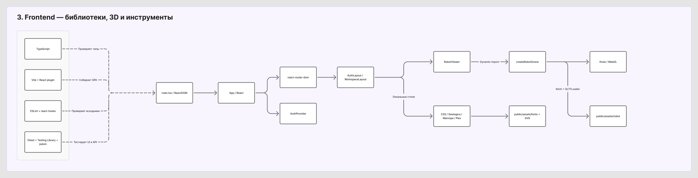

# AI Engineer

Лабораторная работа №4 по дисциплине «Программно-аппаратные средства защиты информации» (ПАСЗИ), вариант 3 — ролевая модель доступа.

Учебное приложение с регистрацией, входом и кабинетом для работы с протоколами испытаний робота. Ролевая модель определяет доступ к чтению и проверке протоколов, а также назначению ролей участникам. 3D-робот следит за курсором и реагирует на действия в форме.

Frontend на React, TypeScript и Vite работает автономно на моках. Для backend на FastAPI и PostgreSQL подготовлены структура, конфигурация и контракт API; серверная логика ещё не реализована.

## Быстрый запуск

Нужны Node.js 24 и npm. Из корня репозитория:

```sh
cd frontend
npm ci
npm run dev -- --host 127.0.0.1
```

Откройте [http://127.0.0.1:5173/](http://127.0.0.1:5173/). Backend и база данных для демо не нужны.

На странице `/register` можно создать аккаунт. Для знакомства с ролевой моделью откройте `/demo` и выберите профиль. Подготовленные аккаунты входят через демо-вход без пароля.

## Ролевая модель доступа

| Роль | Доступ | Демо-профиль |
|---|---|---|
| Оператор | Читает протоколы испытаний | `operator_01` |
| Диагност | Читает и проверяет протоколы: принимает или возвращает на доработку | `diagnostics_01` |
| Архитектор | Проверяет протоколы и назначает роли участникам | `architect_01` |

При регистрации пользователь получает роль Оператора. Если назначить несколько ролей, их права объединяются. После смены ролей интерфейс обновляет доступные действия.

Моки хранят учебные данные в браузере. Настоящие сессии и проверку прав на сервере предстоит реализовать в backend.

## Схема frontend

Компоненты приложения, точка входа, инструменты разработки и загрузка 3D-сцены.



[Открыть схему в полном размере](Docs/assets/frontend-architecture.png) · [Исходник в FigJam](https://www.figma.com/board/dgrrH7faRvqoUOb0qTpwOT?node-id=10-448)

## Структура репозитория

```text
frontend/       React-приложение, моки API, 3D-робот и тесты
backend/        Каркас FastAPI, зависимости и Dockerfile
Docs/           Документация, контракт API и материалы для команды
  assets/       Схемы и изображения для документации
compose.yaml    Конфигурация PostgreSQL и сервисов приложения
```

## Документация

- [Frontend: возможности, маршруты и подключение backend](frontend/README.md)
- [Окружение, Docker Compose и работа команды](Docs/README.md)
- [Контракт API](Docs/API.md) и [спецификация OpenAPI](Docs/openapi.yaml)
- [Документ API для backend-разработчика (.docx)](Docs/AI-Engineer-API-v0.2.docx)

HTTP-адаптеры frontend уже подготовлены. После запуска backend режим HTTP включается переменной `VITE_API_MODE=http` при старте Vite или сборке. Подробности подключения — в инструкции frontend. Изменения контракта нужно отражать в `Docs/API.md` и `Docs/openapi.yaml`.

## Проверки frontend

Из каталога `frontend/`:

```sh
npm run lint
npm test
npm run build
```

Тесты проверяют регистрацию, вход, протоколы и ролевой доступ, а также HTTP-адаптеры через mock fetch. Интеграция с реальным backend ещё не проверена.
